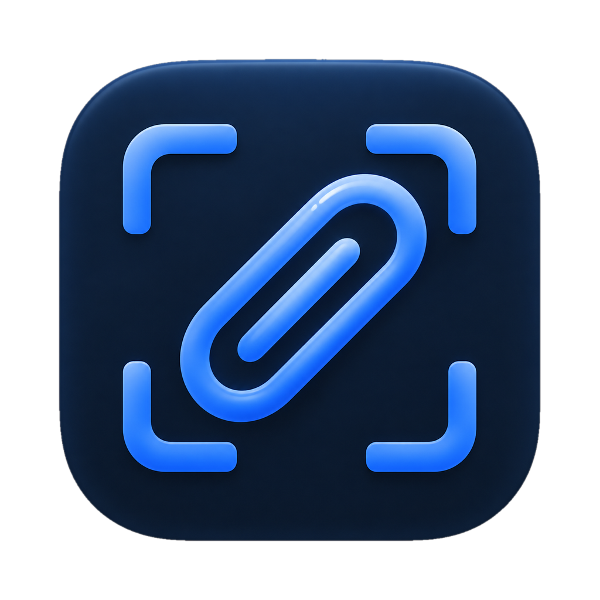
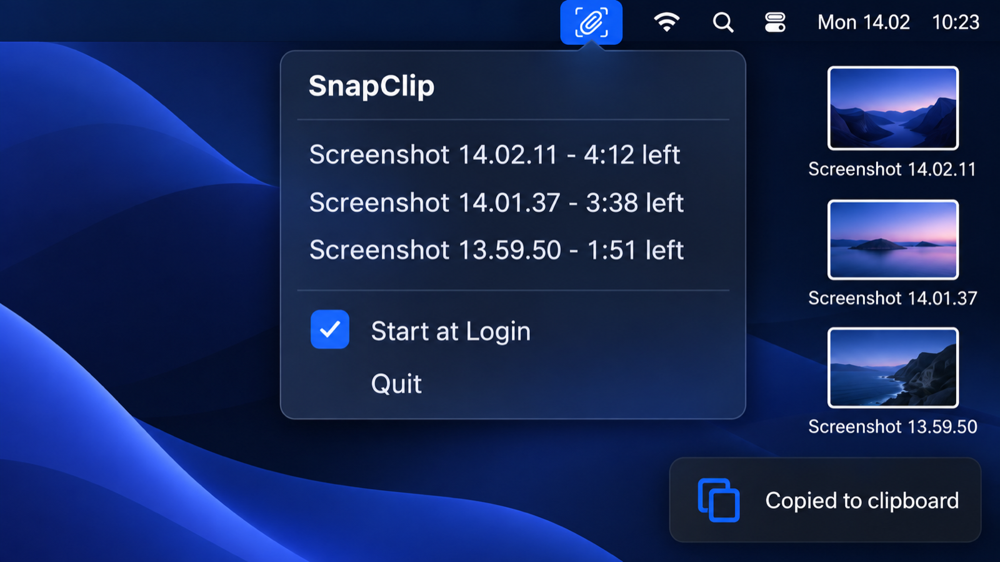
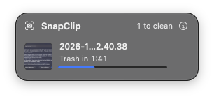

<p align="center"></p>

# SnapClip

A macOS menu-bar app that copies every screenshot to the clipboard and cleans up after itself.

## What it solves

macOS saves screenshots to the Desktop, so it fills up, and you must paste or drag each one by hand. SnapClip copies each new screenshot to the clipboard and keeps the Desktop tidy, without ever deleting a screenshot you chose to keep.





## Features

- Copies each new screenshot (Cmd+Shift+3, 4 or 5) to the clipboard as an image and file URL.
- The file stays in your screenshot folder.
- Keeps at most 5 tracked screenshots; a 6th moves the oldest to the Trash.
- Moves each tracked screenshot to the Trash 5 minutes after it appeared.
- Never touches a file you moved or renamed.
- Optional custom global shortcut (none by default) that starts an interactive area capture; Space switches to window mode, Esc cancels. The file lands in your screenshot folder and is copied like any other. Cmd+Shift+3, 4 and 5 are left to macOS.
- Optional floating capture button (Show Capture Button) that does the same capture on click; drag it anywhere.
- Optional desktop widget (Show Desktop Widget) pinned to the desktop behind your windows. It lists pending screenshots with a thumbnail and time left; click one to copy it, or hover and press the eye button to open it in Preview, Keep, or the trash button to move it to the Trash now. Keep marks the row as kept (no countdown) until you remove it with the x or quit SnapClip (kept rows are cleared on quit; the file itself stays kept); kept files are never trashed. The info button in its header opens About. With nothing listed it collapses to its header.
- Menu bar list with time left per screenshot, Copy, Open in Preview, Keep and Move to Trash actions for each, Instant Copy, Take Screenshot, Capture Shortcut, Show Capture Button, Start at Login, Open Screenshot Folder, Check for Updates, About SnapClip, Quit.

## Install

```sh
brew install 0xnicholasy/tap/snapclip
ln -sf "$(brew --prefix)/opt/snapclip/SnapClip.app" /Applications/SnapClip.app
open /Applications/SnapClip.app
```

First run: macOS asks whether SnapClip may access your Desktop folder (or whichever folder holds your screenshots). Allow it, or screenshots cannot be detected.

## Custom shortcut and capture button

1. Click the SnapClip menu bar icon and choose **Capture Shortcut...**.
2. Press the key combination you want (it needs Cmd, Ctrl or Opt), then click **Save**. **Clear Shortcut** removes it; **Cancel** or Esc keeps the old one.
3. Press the shortcut anywhere to drag-select an area. Press Space to capture a window instead, or Esc to cancel.

Turn on **Show Capture Button** in the menu for a floating button that does the same capture on click. Drag it to move it; SnapClip remembers where you left it. The button hides while you select.

Cmd+Shift+3, 4 and 5 are reserved for macOS and cannot be recorded. If another app already uses your shortcut, SnapClip shows an alert and keeps your previous one.

## Screen Recording permission

The first time SnapClip captures with its own shortcut or button, macOS asks for Screen Recording permission. Allow it in System Settings > Privacy & Security > Screen & System Audio Recording. Captures made with Cmd+Shift+3, 4 or 5 do not need it. After allowing it, quit and reopen SnapClip.

## Updating

SnapClip checks GitHub for a newer release 5 seconds after launch and then every 24 hours. If one exists, the menu shows **Install Update X...** at the top.

- **Check for Updates...** in the menu checks right away and tells you whether you are up to date.
- **Install Update** runs `brew update` and `brew upgrade snapclip` (building from source takes about a minute), then relaunches the new version. Output goes to `~/Library/Logs/SnapClip/update.log`; if the update fails, the alert shows the end of that log.
- If SnapClip was not installed by Homebrew (for example a build from source), **Install Update** opens the release page instead.

To update by hand: `brew upgrade snapclip`.

## Why is there a delay?

When macOS shows the floating screenshot thumbnail in the corner of the screen, it saves the file only after the thumbnail closes (about 10 seconds). SnapClip copies the file as soon as it exists, so the copy arrives late.

Turn on **Instant Copy (no floating thumbnail)** in the SnapClip menu. This sets `show-thumbnail` to false in the `com.apple.screencapture` defaults domain, so macOS saves each screenshot immediately. Untick it to get the thumbnail back. On first launch SnapClip asks whether to turn the thumbnail off.

## Desktop icons are hidden

If macOS hides your Desktop icons (System Settings > Desktop & Dock > Show Items on Desktop), screenshots still land in the folder but you cannot see them on the Desktop. SnapClip shows "Desktop icons are hidden by macOS" in its menu with a "Show Desktop Icons..." shortcut to that settings pane. It never changes the setting itself.

## Build from source

Requires macOS 14+ and the Swift toolchain (Xcode).

```sh
swift test
scripts/build-app.sh      # produces build/SnapClip.app, ad-hoc signed
open build/SnapClip.app
```

## How the rules work

- Watch folder: the `location` key of the `com.apple.screencapture` defaults domain, or `~/Desktop` if unset. It is re-read each time the app starts.
- Detection: a file counts as a screenshot only if it has the extended attribute `com.apple.metadata:kMDItemIsScreenCapture`. Dotfiles are ignored. SnapClip waits for the file size to stop changing before copying. Files that already existed at launch are never copied or tracked.
- Tracking: each screenshot is stored in `~/Library/Application Support/SnapClip/tracked.json` with its path, inode, device and time added.
- Still in place: a file is only SnapClip's to delete while a file at the original path has the same inode and device. If it was moved, renamed or replaced, SnapClip stops tracking it and never touches it.
- Sweep: every 10 seconds and after each new screenshot: drop files no longer in place, trash files tracked for 300 seconds or more, then trash the oldest while more than 5 are tracked. Trashing uses `FileManager.trashItem`, so files are recoverable.
- Keep: stops tracking the file and never trashes it. Its identity stays in `seen`, so it is never tracked again. In the widget, kept rows are cleared when SnapClip quits (the file itself stays kept).
- Move to Trash: trashes a tracked file immediately (recoverable from the Trash).
- Start at Login: writes `~/Library/LaunchAgents/io.github.0xnicholasy.snapclip.plist` (runs `/usr/bin/open -a <app>` at login). Under Homebrew the path is rewritten to `<prefix>/opt/snapclip/...` so upgrades keep working. The toggle is checked when the plist exists; changes apply at next login.

## License

MIT
